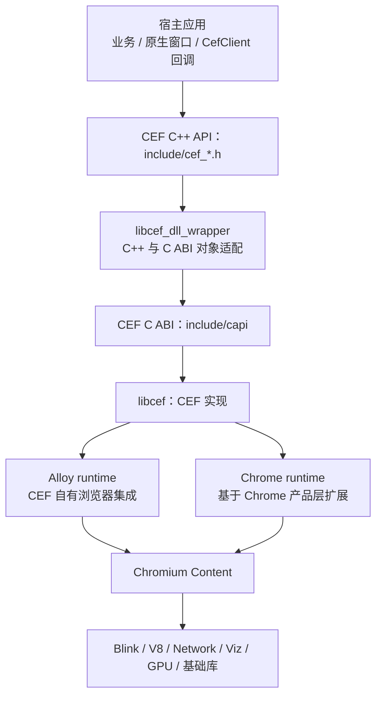
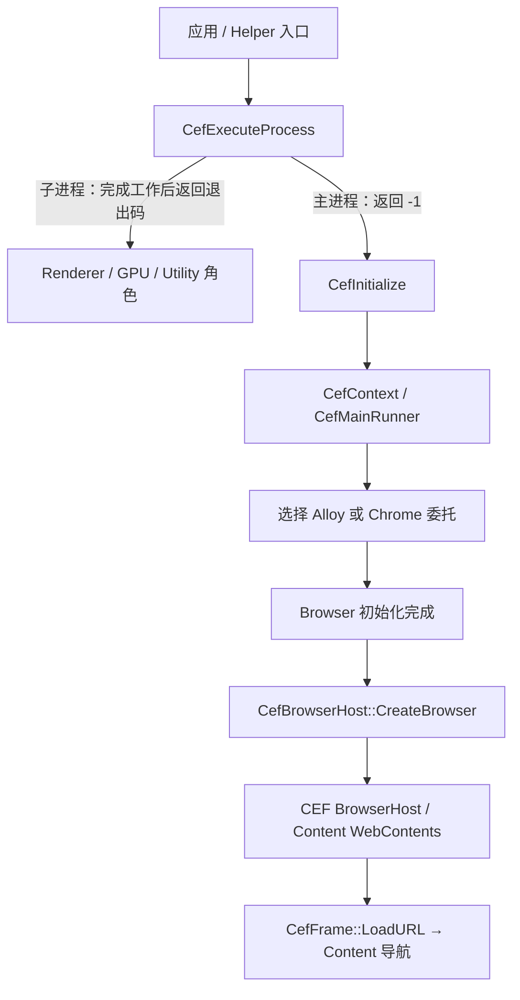

# CEF 模块架构（CEF 104）

CEF 把 Chromium 的浏览器能力封装为嵌入接口。应用负责业务与宿主窗口，CEF 负责 API 适配和浏览器集成，Chromium 负责网页执行、网络、合成及多进程设施。

## 1. 模块结构

这里的 ABI 适配发生在同一进程的调用边界，不是跨进程 RPC。Browser 与 Renderer 之间的通信另由 Mojo/IPC 承担。回调对象也通过包装层反向传回应用。

## 2. CEF 源码分工

以下路径相对 `chromium/src/cef/`。

| 模块 | 职责 | 代表接口或内容 |
|---|---|---|
| `include` | 对应用公开的 C++ 接口 | `CefApp`、`CefClient`、`CefBrowser`、`CefBrowserHost`、`CefFrame` |
| `include/capi` | C 导出接口及带函数指针的结构体 | CEF 的二进制调用边界 |
| `libcef_dll` | C/C++ 转换和导出实现 | `cpptoc`、`ctocpp`、`wrapper`；部分文件由工具生成 |
| `libcef/browser` | 浏览器对象、请求上下文、窗口及回调实现 | `browser_host_base`、`browser_host_create`、`request_context_impl` |
| `libcef/browser/alloy` | Alloy 浏览器侧实现 | `AlloyBrowserHostImpl`、`AlloyContentBrowserClient` |
| `libcef/browser/chrome` | Chrome runtime 浏览器适配 | `ChromeBrowserHostImpl`、`ChromeContentBrowserClientCef` |
| `libcef/renderer` | 渲染端回调、Frame、V8 绑定 | `v8_impl`、`render_frame_observer`、两种 runtime 的 renderer client |
| `libcef/common` | 共用类型、运行时委托及通信定义 | `alloy`、`chrome`、`mojom` |
| `libcef/browser/native`、`views`、`osr` | 原生窗口、Views 与离屏呈现集成 | 按宿主呈现方式选用 |
| `libcef/resources`、`tools`、`tests` | 资源、绑定/分发工具与示例测试 | `cefclient`、`cefsimple` 示例位于 tests 中 |

## 3. CEF 104 的两种 runtime

| 维度 | Alloy runtime | Chrome runtime |
|---|---|---|
| 选择条件 | `CefSettings.chrome_runtime = false` | `CefSettings.chrome_runtime = true` |
| Browser 嵌入点 | `AlloyContentBrowserClient` 继承 `content::ContentBrowserClient` | `ChromeContentBrowserClientCef` 继承 `ChromeContentBrowserClient` |
| 集成方向 | CEF 提供浏览器集成，直接接入 Content | 复用并扩展 Chrome 浏览器实现 |
| 104 版本定位 | 默认路径 | 该版本头文件标为实验性 |
| 构建含义 | 运行时选择 Alloy 不代表产物完全排除 Chrome 代码 | 当前 CEF 构建包含 Chrome 支持所需依赖 |

运行时选择的依据是 [main_runner.cc](../src/cef/libcef/browser/main_runner.cc)；实验性标记来自 [cef_types.h](../src/cef/include/internal/cef_types.h)。不能把新版 CEF 对 runtime 的调整直接套用到 104。

继承关系可核对 [Alloy client](../src/cef/libcef/browser/alloy/alloy_content_browser_client.h) 和 [Chrome client](../src/cef/libcef/browser/chrome/chrome_content_browser_client_cef.h)。

## 4. 公开对象与底层概念

| CEF 对象 | 用途与底层对应关系 |
|---|---|
| `CefApp` | 应用级配置和进程级回调入口；各进程分别创建自己的实例 |
| `CefBrowserProcessHandler` | Browser 进程初始化等回调 |
| `CefRenderProcessHandler` | Renderer 生命周期与脚本上下文等回调 |
| `CefClient` | 单个浏览器实例的回调入口，提供加载、显示、生命周期等 Handler |
| `CefBrowser` / `CefBrowserHost` | 浏览器对象及 Browser 侧控制能力；实现关联 Content 的页面容器 |
| `CefFrame` | 指定 Frame 的加载、脚本及消息操作；不是 Renderer 进程本身 |
| `CefRequestContext` | 请求、Cookie、缓存及相关配置上下文；通过 CEF 实现连接 BrowserContext 等设施 |
| `CefV8Context` / `CefV8Value` | Renderer 侧 V8 对象封装，不能作为跨进程共享指针 |

这些是职责映射，不是所有对象都一对一对应。回调线程以具体头文件约定为准，不能假设所有回调都发生在宿主 UI 线程。

## 5. 启动与调用链

代码入口：[context.cc](../src/cef/libcef/browser/context.cc)、[main_runner.cc](../src/cef/libcef/browser/main_runner.cc)、[browser_host_create.cc](../src/cef/libcef/browser/browser_host_create.cc)。macOS 的主应用和 Helper 往往有不同入口；图表达逻辑分派，不要求所有可执行文件包含相同入口代码。

Browser 与 Renderer 使用 `CefProcessMessage` 等机制交换应用消息；JS 调用本地能力时，可在 Renderer 的 V8 绑定中接收调用，再发消息给 Browser 处理业务并异步返回。`CefV8Handler` 不会自动获得 Browser 进程内的业务对象。

## 6. 宿主集成与 macOS 产物

- **窗口模式**：应用提供原生父视图或使用 CEF Views，CEF 接入原生窗口系统，页面内容仍走 Chromium 的渲染与合成管线。
- **离屏模式（OSR）**：应用通过 `CefRenderHandler` 接收绘制结果，并负责呈现和输入转发；不表示禁用多进程，也不必然禁用 GPU。
- **生命周期**：宿主驱动或集成消息循环；关闭时等浏览器关闭回调完成，再按 API 要求执行 `CefShutdown`。销毁原生窗口不能代替完整浏览器关闭流程。
- **分发**：主应用、Helper、CEF Framework 和资源共同组成运行环境。多个进程可加载同一份 Framework，各自仍有独立地址空间。

API 约束见 [cef_app.h](../src/cef/include/cef_app.h)、[cef_life_span_handler.h](../src/cef/include/cef_life_span_handler.h)、[cef_render_handler.h](../src/cef/include/cef_render_handler.h)。完整依赖分类见 [依赖关系](Chrome与CEF依赖关系.md)。
