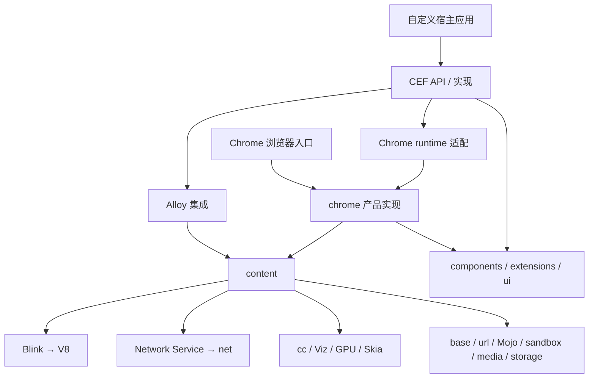
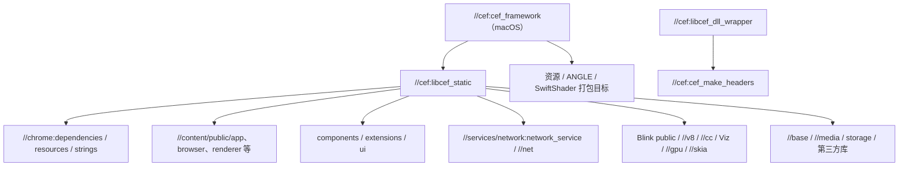
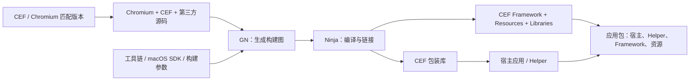

# Chrome 与 CEF 依赖关系（104）

**Chrome 与 CEF 共享 Chromium 基础设施；CEF 不依赖用户安装的 Chrome。** 但本工作区的 CEF 构建明确引用 `//chrome:dependencies` 等目标，因此“CEF 不用 Chrome 可执行文件”不能推导成“CEF 不使用任何 chrome 源码”。

## 1. 先区分四类依赖

| 依赖类型 | 含义 | 本项目示例 |
|---|---|---|
| 源码/API 依赖 | 编译时使用接口或实现 | CEF 使用 Content API；Chrome runtime 继承 Chrome client |
| 构建目标依赖 | GN 声明目标间依赖 | `//cef:cef_framework` 依赖 `//cef:libcef_static` |
| 二进制依赖 | 链接、加载及分发关系 | 宿主加载 CEF Framework，包装库编入应用 |
| 运行时通信 | 不同进程通过消息或共享资源协作 | Renderer 与 Network Service 通过 Mojo 接口通信 |

`DEPS` 也有两种常见用途：源码根部用于依赖检出和版本管理；子目录中的规则可用于约束头文件引用。它们都不能直接替代 `BUILD.gn` 的构建目标依赖。

## 2. Chrome 与 CEF 的共享和差异



图示为主要逻辑关系；CEF 还直接使用 Blink public、V8、net 等目标，并非所有调用都只经过 Content。

| 能力 | Chrome | CEF |
|---|---|---|
| HTML/CSS/JS/Wasm | 使用 Blink/V8 | 复用同一 Chromium 技术栈 |
| 导航、Frame、进程隔离 | 使用 Content | 通过 CEF 集成 Content |
| 标签栏、地址栏、产品窗口 | Chrome 产品层提供 | 由宿主设计或通过选定 runtime/窗口接口提供 |
| 网络、Cookie、代理 | Chromium 网络设施与产品策略 | Chromium 网络设施与 CEF 请求上下文/回调 |
| 扩展、PDF、打印等 | 产品配置控制 | 取决于 CEF 104 API、runtime 与构建配置，不保证完全等同 Chrome |
| Google 在线服务及专有组件 | 随发行版本与授权配置 | 编译相关接口不代表获得服务资格或专有二进制 |

## 3. 本地 GN 构建依赖

下图依据 [CEF BUILD.gn](../src/cef/BUILD.gn) 中实际目标摘录，省略了多数依赖。



`libcef_dll_wrapper` 是应用侧静态包装库，不能替代 CEF Framework。macOS 的核心产物由 `cef_framework` 打包；该 BUILD 文件在其他平台使用 `libcef` shared library 目标。

`deps` 表示构建依赖；`public_deps` 还把依赖暴露给消费者；`data_deps` 常用于运行时所需产物。具体链接结果仍取决于目标类型和构建配置，不能把每条 `deps` 都理解为一条动态库加载关系。

本地 [统一构建配置](../../config/build-profiles.json) 设置 `is_component_build=false`，因此不会把每个逻辑模块都拆成单独动态库；同时 Framework 仍可能携带图形后端等独立库。

## 4. 从源码到应用的依赖链



构建完整 CEF 需要 Chromium 源码树；使用已构建的 CEF SDK 开发宿主应用，通常只需要匹配的头文件、包装库、运行库及资源，不必重新编译整个 Chromium。

版本配对由 [CHROMIUM_BUILD_COMPATIBILITY.txt](../src/cef/CHROMIUM_BUILD_COMPATIBILITY.txt) 指定，本地为 Chromium `104.0.5112.102`。C ABI 用来隔离跨库的 C++ 对象调用，但不保证任意 CEF 版本之间可直接替换；应用头文件、包装库和 Framework 应使用匹配分发版本。

## 5. macOS 部署依赖

```text
宿主.app/
└── Contents/
    ├── MacOS/宿主
    ├── Frameworks/
    │   ├── Chromium Embedded Framework.framework/
    │   │   └── Versions/A/
    │   │       ├── Chromium Embedded Framework
    │   │       ├── Resources/   # pak、locale、ICU、V8 snapshot 等
    │   │       └── Libraries/   # 配置所需的图形后端等库
    │   └── 宿主 Helper*.app/    # 具体名称和数量依分发配置而定
    └── Resources/
```

这是逻辑布局，省略 Framework 的版本符号链接。实际资源位置应以构建分发包和宿主配置为准，不能仅复制 Framework 中的主二进制。

| 依赖 | 作用 | 配置错误时的常见表现 |
|---|---|---|
| CEF Framework | 浏览器核心实现 | 加载失败、符号或版本不匹配 |
| CEF 包装库与头文件 | 应用调用适配 | 编译/链接失败，或不兼容调用 |
| Helper 与启动配置 | 承载 Renderer/GPU/Utility 等角色 | 子进程无法启动，页面崩溃或功能缺失 |
| pak、locale、ICU、V8 snapshot | 资源、本地化、国际化和脚本初始化数据 | 缺资源、初始化失败或运行异常 |
| 图形后端库 | 硬件/软件图形路径 | GPU 初始化失败、回退或黑屏 |
| 系统框架与最低系统版本 | AppKit、图形和 OS API 支持 | 旧系统缺符号或无法启动 |
| 架构一致性 | 主程序、Helper、库及相关数据匹配 CPU | arm64/x86_64 加载或初始化失败 |
| 签名、权限及沙箱配置 | macOS 加载与子进程执行条件 | 加载、启动或资源访问被拒绝 |

本工作区使用 SDK 12.3，提供最低 macOS 11.0、12.0 两套配置，分别构建 arm64 与 x86_64 后合并。此为工作区配置，不是 CEF 104 原始发行包的统一要求。V8 snapshot 的双架构处理属于本地修改，见 [修改说明](CEF104自定义补丁说明.md)；构建和验证范围见 [构建说明](../../docs/build-guide.md)。

Chromium 子进程沙箱、macOS App Sandbox、V8 sandbox 是不同机制；不能从某一个开关推断其他机制已启用或关闭。

## 6. 如何查精确目标依赖

以下命令从 `chromium/src/` 执行，使用已经生成的本地输出目录。文档中的架构图不替代这些目标级查询。

```bash
# macOS Framework 的直接依赖。
gn desc out/cef104-macos12-arm64 //cef:cef_framework deps

# CEF 核心依赖树（输出可能较大）。
gn desc out/cef104-macos12-arm64 //cef:libcef_static deps --tree

# Framework 到 V8 的一条依赖路径。
gn path out/cef104-macos12-arm64 //cef:cef_framework //v8:v8

# 查看编译开关。
gn args out/cef104-macos12-arm64 --list
```

这些是复查命令示例，本文没有执行完整依赖导出或重建。查询另一套配置时，要替换输出目录；平台和 GN 参数会改变目标图。

定位问题时：产品功能先看 `chrome/` 或 CEF Handler；导航和进程先看 `content/`；DOM/布局看 Blink；脚本引擎看 V8；请求看 Network Service/net；黑屏与合成看 CEF 呈现层及 cc/Viz/GPU；加载失败看应用包、架构、资源和签名。

## 7. 依据与适用范围

本地源码是版本依据：

- [Content 模块边界](../src/content/README.md) 与 [公开 API](../src/content/public/README.md)。
- [CEF 构建目标](../src/cef/BUILD.gn)、[运行时选择](../src/cef/libcef/browser/main_runner.cc)。
- [CEF C 导出入口](../src/cef/libcef_dll/libcef_dll.cc)、[macOS Framework 加载接口](../src/cef/include/wrapper/cef_library_loader.h)。
- [Network Service 部署与信任边界](../src/services/network/README.md)。

在线背景资料：[Chromium 多进程架构](https://www.chromium.org/developers/design-documents/multi-process-architecture/)、[源码目录导览](https://www.chromium.org/developers/how-tos/getting-around-the-chrome-source-code/)。在线资料包含跨版本或历史描述，本文的 104 行为以本地代码为准。
