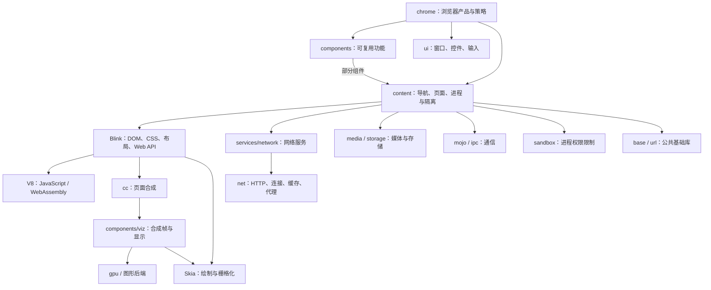
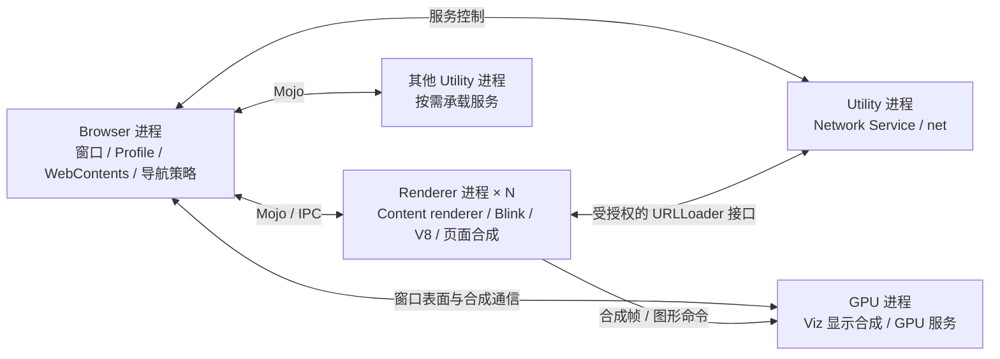
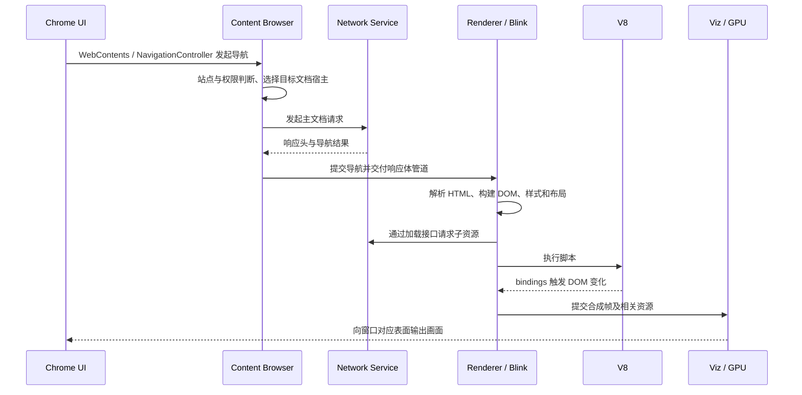

# Chrome 模块架构（Chromium 104）

Chrome 的核心分层是：**浏览器产品层 → Content 嵌入层 → 页面引擎与基础设施**。产品层决定浏览器“提供什么功能”，Content 管理网页与进程，Blink/V8 执行网页内容。

这里的 Chrome 架构指本地 Chromium 源码中的桌面浏览器实现。Google Chrome 的专有发行组件、服务授权及品牌配置不在本地源码架构审计范围内。

## 1. 模块总图

这是职责关系图，省略了共享底层依赖及部分中间接口。`components` 不是固定单层：如书签属于产品功能，Viz 属于图形基础设施；不能把整个目录当作一个 GN 目标。

## 2. 模块职责和源码入口

以下路径均相对 `chromium/src/`。

| 模块 | 主要职责 | 边界与依赖 |
|---|---|---|
| `chrome/app` | 程序入口、主委托、进程启动分派 | 接入 Content 生命周期 |
| `chrome/browser` | 窗口、标签、Profile、权限及产品策略 | 使用 Content、components、ui |
| `chrome/renderer` | 注入 Chrome 特有的渲染端功能 | 基于 Content 渲染端扩展接口 |
| `chrome/common` | Chrome 跨进程共用定义 | 不等于通用基础库 |
| `components`、`extensions` | 偏好、书签、自动填充等可复用功能与扩展系统 | 按子模块选用；Content 不包含完整 Chrome 功能 |
| `content/public` | 提供给 Chrome、CEF 等嵌入方的接口 | `WebContents`、`BrowserContext`、`ContentBrowserClient` 等 |
| `content/browser` | 导航、文档宿主、站点实例、子进程和权限边界 | 管理页面执行环境，不承担完整浏览器 UI |
| `content/renderer` | 渲染进程基础设施、Frame 与 Blink 接入 | 连接 Blink 与浏览器侧宿主 |
| `third_party/blink/renderer` | HTML/CSS、DOM、布局、Web API 与绘制记录 | `core`、`modules`、`platform`、`bindings` 分工 |
| `v8` | JavaScript、WebAssembly、垃圾回收与 JIT | 不实现 DOM；通过 Blink bindings 接入 Web 对象 |
| `services/network`、`net` | 服务接口与底层网络协议栈 | Network Service 基于 net；二者不是两个必然独立的进程 |
| `cc`、`components/viz` | 页面合成、帧聚合和显示 | 页面合成与最终显示职责分离 |
| `gpu`、`third_party/angle`、`skia` | GPU 通信、图形 API 适配、2D 绘制 | 后端随平台、构建与运行参数变化 |
| `media`、`storage` | 音视频管线、浏览器存储设施 | 会跨进程使用服务及平台能力 |
| `ui` | Views、事件、几何、原生窗口集成 | 浏览器界面与网页渲染不是同一套对象 |
| `base`、`url`、`mojo`、`ipc`、`sandbox` | 任务、线程、URL、通信与沙箱 | 被多个上层模块复用 |

层级规则和接口依据：[Content 说明](../src/content/README.md)、[Content API](../src/content/public/README.md)、[Components 说明](../src/components/README.md)。Content 通过嵌入接口回调 Chrome，而不是反向依赖 `chrome/` 实现。

## 3. 运行时进程关系

这是桌面环境的典型配置：Network Service 可以部署在 Browser 进程内，GPU 与其他服务也受配置影响。服务不等于独立进程，主进程也不是只执行 UI。

一个标签页不等于一个 Renderer：跨站 iframe 可以使用其他 Renderer，不同页面在满足策略时也可能共享进程。`WebContents` 表示页面容器，`RenderFrameHost` 表示浏览器侧文档宿主，`RenderProcessHost` 管理渲染进程；这些都不是独立 OS 进程。[官方多进程架构](https://www.chromium.org/developers/design-documents/multi-process-architecture/)

网络服务的位置和信任边界见本地 [Network Service 说明](../src/services/network/README.md)：Browser 控制可信的 `NetworkContext`，Renderer 使用受约束的加载接口。

## 4. 一次网页导航的主要链路

这是导航与显示的简化主链，不表示所有字节都经 Browser 拷贝，也不表示全部绘制都在 GPU 上完成。脚本、子资源加载、布局和绘制可以交错执行。

进一步阅读：[Blink](../src/third_party/blink/renderer/README.md)、[cc](../src/cc/README.md)、[Viz](../src/components/viz/README.md)。
