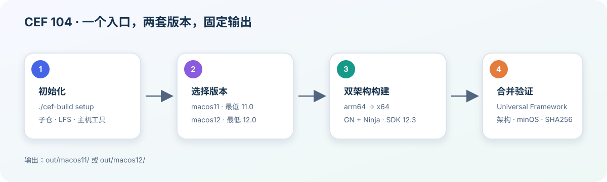

# CEF 104 构建说明

## 使用入口

所有日常操作都从仓库根目录的 `cef-build` 开始：

| 命令 | 作用 |
| --- | --- |
| `./cef-build setup` | 同步所有子仓与 LFS，并按当前 Mac 架构恢复固定工具 |
| `./cef-build doctor` | 只读检查环境、提交、工具架构、SDK 和已有产物 |
| `./cef-build build [macos11\|macos12] [--jobs N]` | 生成双架构配置、续编、合并并验证；默认 `macos12` |
| `./cef-build clean <macos11\|macos12\|obsolete>` | 把入口管理的目录移到废纸篓；脚本中使用 `--yes` |

`setup` 不安装 Xcode/Command Line Tools。它们需要系统安装并接受许可。私有工具归档使用 Git LFS，克隆账号必须有访问权限。

## 配置和目录

`config/build-profiles.json` 是唯一配置源。它保存两套部署版本、SDK 版本、目标架构、公共 GN 参数和预期源码提交，不包含本机绝对路径。运行构建时，入口才把当前工作区的 SDK 路径写入生成的 `args.gn`。

```text
config/build-profiles.json
        │
        ├─ macos11 → mac_deployment_target = 11.0
        └─ macos12 → mac_deployment_target = 12.0
                     SDK = 12.3
                     targets = arm64 + x64
```

生成内容固定放在以下位置，均由 `.gitignore` 排除：

| 内容 | 路径 |
| --- | --- |
| 编译缓存 | `chromium/src/out/cef104-<版本>-<架构>/` |
| 日志和状态 | `.cef-build/<版本>/` |
| 最终 Framework 与 manifest | `out/<版本>/` |

旧工作区的四个缓存曾尝试直接迁移到统一名称，但 Chromium 预编译头文件内含原输出路径。入口会在统一名称不存在时自动复用这四个历史目录；新克隆和新构建使用上表中的统一名称，最终产物路径不受影响。

## 构建和验证流程



每次构建按顺序执行：

1. 核对当前主机工具架构、SDK 12.3 和所有固定源码提交。
2. 为 arm64 写入 `args.gn`，执行 `gn gen` 和 Ninja 增量构建。
3. 为 x64 执行同样步骤。目标架构与主机架构相互独立。
4. 逐文件比较共享资源，保留两套 V8 架构快照，并用 `lipo` 合并四个核心 Mach-O。
5. 检查四个文件均含 `arm64`、`x86_64`，最低系统版本匹配配置，SDK 均为 12.3。
6. 生成包含源码提交、源码工作树是否有本地改动及全部文件 SHA256 的 `build-manifest.json`，再原子替换最终输出。

日志追加到 `.cef-build/<版本>/build.log`。失败时编译缓存保留，重试同一命令即可由 Ninja 续编。

## 子仓关系

主仓只保存编排、配置和文档。源码与工具通过固定提交的子仓关联：

```text
cef-sandbox-104
├─ chromium/src
│  ├─ cef
│  ├─ v8
│  └─ third_party/google_toolbox_for_mac/src
├─ depot_tools
└─ cef_build_tools  (Git LFS: SDK 和双主机工具归档)
```

`./cef-build setup` 使用 `git submodule update --init --recursive`，所以新电脑无需逐个克隆这些仓库。更新某个子仓后，仍需在其父仓提交新的 gitlink 指针，主仓才会固定到新版本。

## 工具选择

`cef_build_tools/manifest.json` 把 SDK 12.3 作为公共资源，把 Clang、GN、depot runtime 分成 `darwin-arm64` 和 `darwin-x86_64`。恢复脚本根据当前主机选择一组，校验文件大小与 SHA256，并拒绝恢复错误架构。

Intel 工具来自 Chromium 104 固定的官方版本。它们已在 Apple Silicon 上通过 Rosetta 完成可执行文件版本、架构和最小编译检查。Intel Mac 的完整 Universal CEF 构建仍列为待验收项目。

## 清理

`clean` 只处理入口明确管理的目录，并把内容移到 macOS 废纸篓：

```bash
./cef-build clean macos11
./cef-build clean macos12
./cef-build clean obsolete
```

`obsolete` 只涵盖已废弃的 10.13/Debug 输出、旧下载与源码解压目录、旧日志/状态/备份，以及完成迁移后遗留的旧 Universal 目录。它不会删除 11.0、12.0 的统一命名缓存。

本仓库只生成并验证 CEF Framework，不替换 `niimbot_cef_bridge` 或其他项目中的运行库。
